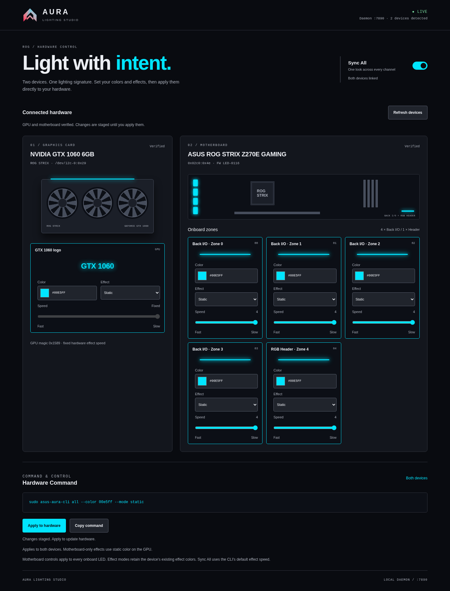

<div align="center">


# ASUS Aura Controller

Control ASUS Aura RGB on Linux without ASUS software: a small Rust CLI, a local web studio, and an MCP server so coding agents can use your case lighting as a status light.

[](https://github.com/alexkala/asus-aura-controller/actions/workflows/ci.yml)
[](LICENSE)
[](Cargo.toml)
[](#mcp-server)
[](#hardware-support)

[](web/screenshot.png)

</div>

> **Unofficial.** Not affiliated with or endorsed by ASUS or NVIDIA. This tool writes to hardware registers. Read [Safety and permissions](#safety-and-permissions) before running it on anything other than the tested hardware.

## Hardware support

The CLI is hard-wired to the hardware below and refuses to write if the identity check fails.

| Device | Status | Access path | Identity check |
| --- | --- | --- | --- |
| NVIDIA GeForce GTX 1060 6GB (ASUS ROG Strix) | Tested | `/dev/i2c-0`, address `0x29` | register `0x20`/`0x21` must read `0x1589` |
| ASUS ROG STRIX Z270E GAMING | Tested | Nuvoton NCT6793D Super I/O at port `0x02c0`, SMBus slave `0x4e`, via `/dev/port` | ENE firmware name must start with `LED-0116` |
| Other ASUS ROG boards (NCT6791D / NCT6793D / NCT6796D / NCT6798D) | **Not supported yet** | n/a | n/a |

What "tested" covers: the maintainer's own machine (x86_64 Linux). The agent-state patterns in the MCP server use motherboard writes (per-zone color, effect-color buffer) that so far have only mock-register tests; see [MCP server](#mcp-server).

**Other boards.** Many ROG boards pair one of those Super I/O chips with an ENE controller, which is why they are plausible targets, but nothing here has been tried on them. The bus number (`/dev/i2c-0`), port base (`0x02c0`), slave address and firmware prefix are constants in [`src/protocol.rs`](src/protocol.rs), and a mismatch aborts before any write. Please do not edit those checks to "make it work" on your board; follow [CONTRIBUTING.md](CONTRIBUTING.md#adding-support-for-a-new-board-or-gpu) so support lands with a verified identity check and tests.

## Quickstart

Requires a recent stable Rust toolchain (developed on 1.98), Linux, and for live use the `i2c-dev` kernel module.

```sh
git clone https://github.com/alexkala/asus-aura-controller && cd asus-aura-controller
cargo build --release
cargo test
```

### CLI

Always start with `--dry-run`: it exercises the same code paths, opens no device and prints the register writes it would make.

```sh
./target/release/asus-aura-cli --dry-run status
./target/release/asus-aura-cli --dry-run --json status
./target/release/asus-aura-cli --dry-run gpu --color ff0055 --mode breathing
./target/release/asus-aura-cli --dry-run mobo --color 112233
./target/release/asus-aura-cli --dry-run mobo --mode rainbow-breathing --speed 2
./target/release/asus-aura-cli --dry-run all --color 00ffcc --mode breathing
./target/release/asus-aura-cli --dry-run all --off
```

For live control drop `--dry-run` (the motherboard needs root; see below). `--off` beats color and mode. GPU and motherboard modes default to static; motherboard speed is 0–4 where 0 is fastest. `all` needs `--color` unless `--off` is given. Modes the GPU lacks fall back to static GPU color, and non-static motherboard modes keep the existing effect colors. Dry-run `status` prints canned values, not live readings.

### Web Studio

```sh
python3 web/serve.py          # http://127.0.0.1:7890  (override the port with AURA_PORT)
```

Opening `web/index.html` directly from disk gives a simulation only. Through `serve.py` the page reads status and **applies changes to real hardware** by running `sudo -n asus-aura-cli`, so it needs the sudoers rule from [SECURITY.md](SECURITY.md#least-privilege-sudoers). It listens on `127.0.0.1` only and has no authentication; any local user can reach it. Set `AURA_CLI_BIN` to point it at an installed binary.

### MCP server

```sh
./target/release/asus-aura-cli --dry-run mcp      # try it without touching hardware
```

Install the binary somewhere root-owned and register it with your agent (config snippets for Claude Desktop and Antigravity are in [`mcp/`](mcp/)):

```sh
sudo install -m 0755 target/release/asus-aura-cli /usr/local/bin/asus-aura-cli
```

```json
{ "mcpServers": { "asus-aura": { "command": "sudo", "args": ["-n", "/usr/local/bin/asus-aura-cli", "mcp"] } } }
```

## MCP server

Each agent starts its own server process. Hardware access is serialized with advisory locks on the device files themselves (`/dev/i2c-0`, `/dev/port`). The saved baseline is per process: agents setting states simultaneously can capture each other's pattern as their baseline. Have only one agent drive `aura_agent_state` at a time.

Within one server, baselines are kept per device. A device joins an agent pattern only after its baseline was read successfully (otherwise it is skipped and reported under `warnings`), an explicit set/off call releases only the devices it changed, and a failed restore on one device is retried (up to 3 times) without rewriting the other. If the client stops reading replies or closes stdout, the server restores the saved lighting and exits with an error.

`asus-aura-cli mcp` speaks newline-delimited JSON-RPC 2.0 on stdio (protocol versions 2025-06-18, 2025-03-26, 2024-11-05). stdout carries protocol messages only; logs and `--dry-run` register traces go to stderr.

| Tool | Arguments | Notes |
| --- | --- | --- |
| `aura_get_status` | none | Device state, firmware, active agent hold. Motherboard `zones` report the active color buffer (`color_source`: `direct` or `effect`), i.e. the configured color, not a sample of a running animation. A device that cannot be opened reports `{"error": ...}` instead of failing the call. |
| `aura_set_color` | `color`, `target` (`all`/`gpu`/`mobo`), `zone` (0–4, motherboard only) | |
| `aura_set_effect` | `mode`, `color?`, `target?`, `speed?` (0–4, motherboard only) | The GPU supports static, breathing, strobing, color-cycle. Other modes fall back to static GPU color and the response `notes` say so. |
| `aura_turn_off` | `target?` | |
| `aura_agent_state` | `state` (`working`/`reviewing`/`success`/`failure`/`idle`), `duration_seconds?` | working = amber breathe, reviewing = cyan wave (GPU holds static cyan), success = green pulse, failure = red strobe. The previous lighting is saved and restored on `idle`, after 3 s for success/failure, or after 15 min for working/reviewing. An explicit set or off call cancels the hold. |

Resources: `aura://hardware/topology` (static) and `aura://state/current` (live read).

Without root the GPU still works (`i2c` group) and `aura_agent_state` degrades to the GPU, reporting the motherboard under `warnings`. The failure pattern uses the hardware's flashing effect; avoid it if you are sensitive to flashing light.

Hardware status: per-zone color, the effect-color buffer (`0x8010`, five LEDs max) and snapshot/restore are covered by mock-register tests and a stdio test suite (`cargo test --test mcp_stdio`), not yet by a live run. Try one `aura_set_effect` call on your hardware before relying on agent states.

## Architecture

```
agents (MCP) ─┐
web studio ───┼─► asus-aura-cli ─┬─ gpu.rs   I2cBus ─► /dev/i2c-0 @ 0x29        (NVIDIA I2C, SMBus byte)
CLI ──────────┘   main.rs/mcp.rs └─ mobo.rs  PortIo ─► /dev/port ─► NCT6793D SMBus ─► ENE LED-0116 @ 0x4e
                  protocol.rs: registers, modes, color packing, identity constants
```

- `src/protocol.rs`: register map, mode enums, hex parsing, RBG packing (ENE buffers store red, blue, green).
- `src/gpu.rs` / `src/mobo.rs`: one controller per device behind small transport traits (`I2cBus`, `PortIo`), so real, dry-run and mock transports share the same logic and every write is preceded by an identity check.
- `src/mcp.rs`: the MCP server. It plans a write first (pure, unit-tested), then applies it per device and reports exactly what each device did.
- `web/`: the Studio front end and `serve.py`, a small localhost bridge to the CLI. `aura_ctl.py` is the original Python reference implementation.
- How the protocols were derived, and what is still unknown: [REA_ANALYSIS.md](REA_ANALYSIS.md). No vendor binaries are in this repository.

## Safety and permissions

- **Identity gates.** Every controller call first reads and verifies the device identity (GPU magic `0x1589`, motherboard firmware prefix `LED-0116`) and aborts on mismatch. Do not bypass them.
- **Hard-coded locations.** The GPU bus is `/dev/i2c-0` and the motherboard port base is `0x02c0`. On another machine `/dev/i2c-0` may be a different device. Check `i2cdetect -l` before running anything live.
- **Two privilege levels.** The GPU needs access to `/dev/i2c-*` (group `i2c`, see [`udev/99-asus-aura.rules`](udev/99-asus-aura.rules)). The motherboard needs `/dev/port`, which means root. That rule is broad: it opens every i2c bus to the group, including DIMM SPD buses, so add only trusted users.
- **Passwordless sudo must target a root-owned binary.** A sudoers rule for a file you can write (such as `target/release/…`) hands you root. Install the binary first and use the rule in [SECURITY.md](SECURITY.md#least-privilege-sudoers).
- **One tool at a time.** Do not run other RGB software (OpenRGB, vendor tools) against the same buses while this runs.
- **Kernel lockdown** (for example Secure Boot setups) can block `/dev/port` entirely.
- **No warranty.** See [LICENSE](LICENSE). Writing to the wrong device can misbehave in ways this project cannot predict.

## Contributing and security

- [CONTRIBUTING.md](CONTRIBUTING.md): dev setup, safe testing with `--dry-run`, adding a new board or GPU.
- [SECURITY.md](SECURITY.md): privilege model, sudoers rule, how to report a vulnerability.

## License

MIT, see [LICENSE](LICENSE).
